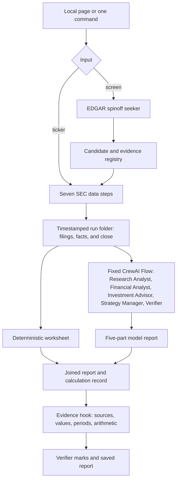

# Checkpoint 3 — Three Checks

**Team:** Three Checks  
**Members:** Aditi Nahane, Shachi, and Mrunalini

## Desk design and joins

The code fixes the order. The seeker passes a selected ticker to the seven SEC data steps. Those steps save filings and XBRL facts. The fixed CrewAI Flow writes the five-part report. The worksheet reads the saved facts and market close, then prints its formulas. The evidence hook checks the model report and worksheet. The Verifier checks filing meaning and saves marks. The hook and Verifier can refuse a report.

**Current implementation:** The repository contains the seven SEC steps, fixed CrewAI Flow, Verifier, LSEG close reader, Streamlit page, EDGAR seeker, worksheet, evidence hook, and one-command pipeline. Twenty-five local unit tests pass. The EDGAR seeker saved 56 Form 10 candidates, but it ranked 0 because required factor data is missing. The GOOGL and MSFT Lab 09 model reports were refused by the evidence hook. Their updated worksheets and worksheet checks pass. The team-authored valuation inputs now agree on the course formula, rates, deciding number, and $10,000,000 client portfolio. The Streamlit page has not yet been run by a partner.

## What the team owns

**Three Checks owns the filing evidence hook and audit trail.** The hook checks numbers against saved SEC facts, filings, or printed calculations. It writes marks in each run folder and stops a report that fails the checks.

## Member roles

- **Aditi Nahane:** integrate SEC and LSEG data, the run workflow, and the filing-backed run evidence.
- **Shachi:** lead claim audits and check the Verifier's marks against saved filing text.
- **Mrunalini:** lead the valuation worksheet and report interface, and record assumptions and limits.

## Live record so far

There is no eligible report in `runs/live`. These Lab 09 runs were made on 2026-11-22, after the earnings filings. They are practice runs, not views recorded within 24 hours of a release. No commit time is recorded.

| Ticker | Filing and Accepted time (Eastern) | Run time (Eastern) | Model report | Worksheet | Live within 24 hours? |
|---|---|---|---|---|---|
| GOOGL | 2026-10-28 16:01:33 | 2026-11-22 16:27:39 | Refused: 7 claims refused | Arithmetic/source hook passed; reconciled policy; Sell / Avoid; 0.0% ($0.00) | No |
| MSFT | 2026-10-28 16:04:44 | 2026-11-22 16:31:02 | Refused: 6 claims refused | Arithmetic/source hook passed; reconciled policy; Sell / Avoid; 0.0% ($0.00) | No |

The partner selected Google and Microsoft. This work uses `GOOGL` for Google (Alphabet Inc., Class A); the partner must confirm that ticker choice. [Lab 09 comparison and partner hand-check sheet](Lab09_GOOGL_MSFT_Comparison.md).

## Checkpoint 3 status

This Markdown page contains the team name, member names, desk diagram, joins, team-owned work, roles, and live record. The linked Lab 09 comparison is supporting evidence. The partner's manual checks remain blank. The page has not been uploaded to Brightspace. The model reports are refused, so the worksheet recommendations alone do not complete the Lab 09 verification requirement.

Course references: [Checkpoint 3 grading entry](https://cinderzhang.github.io/FIN67110-Fall2026/grading.html) · [Lab 09 instructions](https://cinderzhang.github.io/FIN67110-Fall2026/week-05/lab-09-prove-it-together.html)
